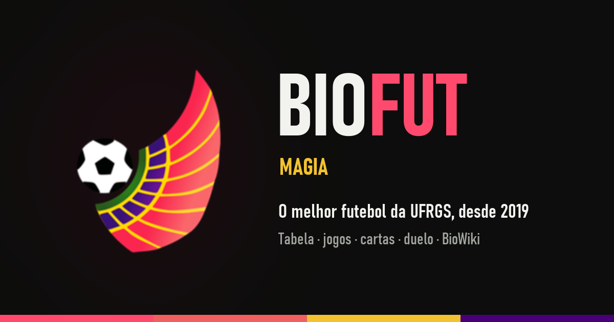
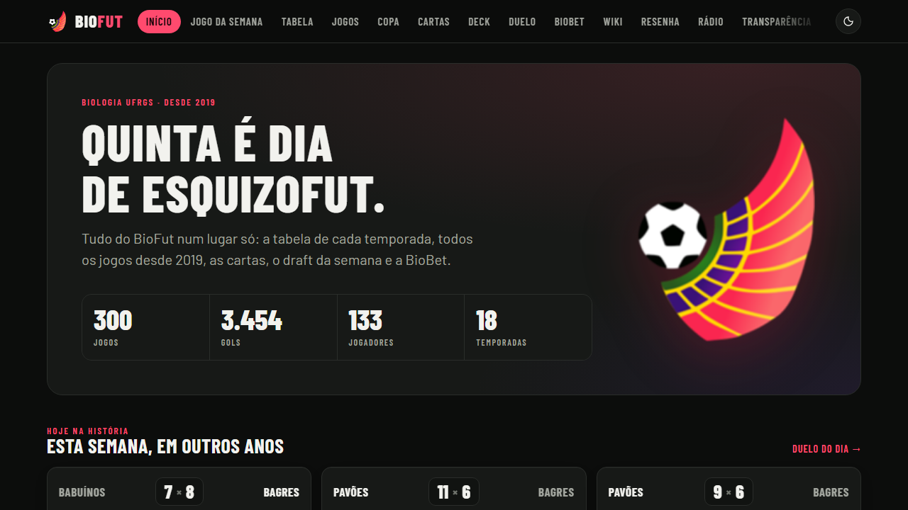
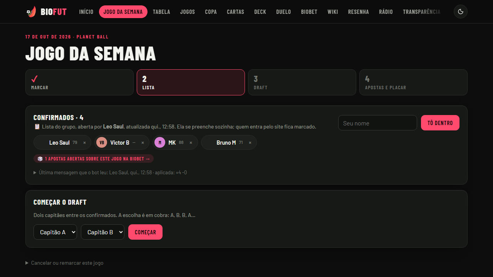
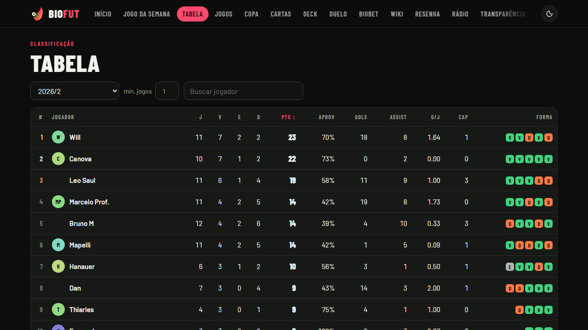
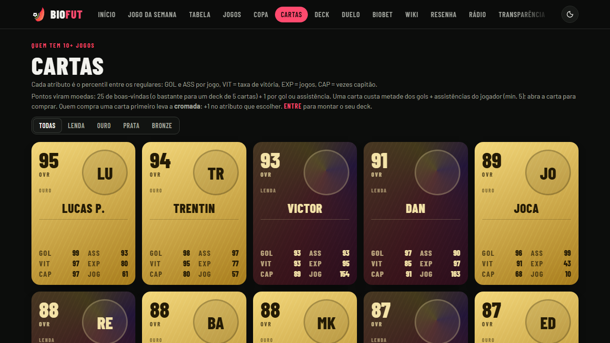
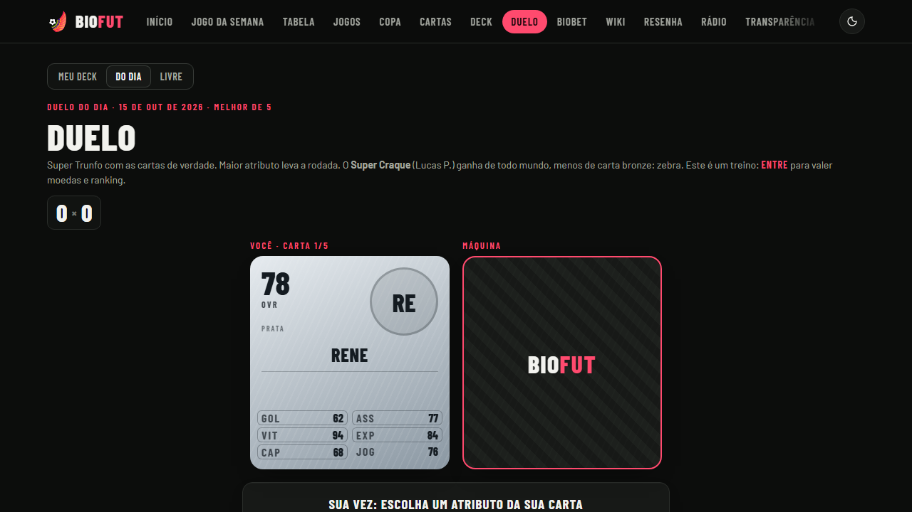
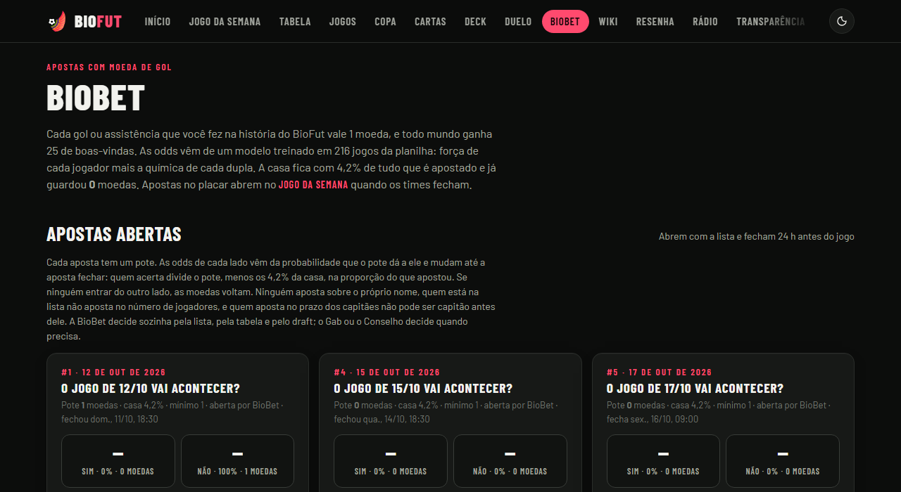
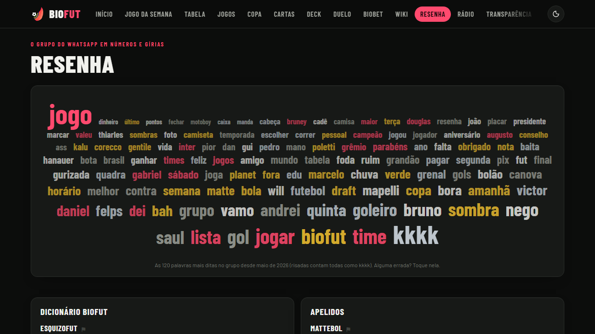

<b><a href="https://biofut.h-brain.org">biofut.h-brain.org</a></b> · 300 jogos · 3.454 gols · 133 jogadores · 18 temporadas

# BioFut

Site e ferramentas da pelada BioFut, a pelada da Biologia da UFRGS desde 2019. Tabela do campeonato e estatísticas que se atualizam sozinhas (WhatsApp, prints de súmula e o histórico do Excel), mais as camadas de zoeira por cima: draft, BioBet, cartinhas, duelo, bot de WhatsApp.

Projeto feito pela galera do grupo, para o grupo. Quer ajudar? Leia o [CONTRIBUTING.md](CONTRIBUTING.md) e pegue uma issue. Issues com etiqueta `bounty` pagam em gols e assistências: veja [BOUNTIES.md](BOUNTIES.md). Ideias e bugs mandados pelo botão do site viram issue aqui automaticamente.

## O que tem no site

<table>
<tr>
<td width="50%"></td>
<td width="50%"></td>
</tr>
<tr>
<td><b>Início</b>: os números da história toda e "esta semana, em outros anos", os jogos da mesma semana nas temporadas passadas.</td>
<td><b>Jogo da semana</b>: marcar, lista, draft, apostas e placar. A lista se preenche sozinha pelo bot do WhatsApp; o draft é com dois capitães, escolha em cobra (A, B, B, A…).</td>
</tr>
<tr>
<td></td>
<td></td>
</tr>
<tr>
<td><b>Tabela</b>: classificação de cada temporada, com aproveitamento, gols, assistências, capitanias e a forma dos últimos jogos. <b>Jogos</b> e <b>Copa</b> guardam todos os resultados desde 2019.</td>
<td><b>Cartas</b>: cartinha de cada regular, com atributos em percentil (GOL, ASS, VIT, EXP, CAP) e níveis Lenda, Ouro, Prata e Bronze. Gols e assistências viram moedas para comprar cartas; quem compra primeiro leva a cromada. Monte o seu <b>Deck</b>.</td>
</tr>
<tr>
<td></td>
<td></td>
</tr>
<tr>
<td><b>Duelo</b>: Super Trunfo com as cartas de verdade contra a máquina. Duelo do dia, modo livre ou com o seu deck, valendo moedas e ranking.</td>
<td><b>BioBet</b>: apostas com moeda de gol. As odds vêm de um modelo treinado em 216 jogos (força de cada jogador mais a química de cada dupla); a casa fica com 4,2%.</td>
</tr>
<tr>
<td></td>
<td>
<b>Resenha</b>: nuvem com as palavras mais ditas no grupo, o dicionário BioFut e os apelidos.  
E ainda: <b>Wiki</b> (a BioWiki), <b>Rádio</b>, <b>Transparência</b> (para onde vai o dinheiro) e <b>Apoie</b> (Pix para manter o site no ar).
</td>
</tr>
</table>

## O que tem no repositório

- `site/`: o site no ar. Python puro (stdlib), sem framework. Os jogos vêm ao vivo da planilha do grupo (a cada 10 min).
  `python server.py` roda local; precisa de um `biofut.json` (gerado por `build_data.py`, fora do git). Testes: `python -X utf8 site/test_site.py`.
- `bot/`: o bot de WhatsApp que lê a lista do grupo e preenche o jogo da semana. Testes: `node bot/test.js`.
- `dashboard/`: o B.D.S.M. (BioFut Department of Statistical Magic), dashboard React + Vite + Tailwind + recharts de 2025.
- `docs/`: as imagens deste README.

Deploy (`site/deploy.ps1`, `bot/deploy-bot.ps1`): defina `BIOFUT_SSH_KEY`, `BIOFUT_HOST_IP`, `CF_ZONE_ID` e `CF_TOKEN_FILE` no ambiente.

## O que não entra no repositório

Dados pessoais do grupo (planilha, telefones, export do WhatsApp, fotos). Eles ficam fora do git (`.gitignore`). Para desenvolver, use dados de exemplo. As imagens em `docs/` são do site público, com as fotos escondidas.

## Ajude a manter o site no ar

Veja [DONATE.md](DONATE.md).

## Licença

MIT. Veja [LICENSE](LICENSE).
